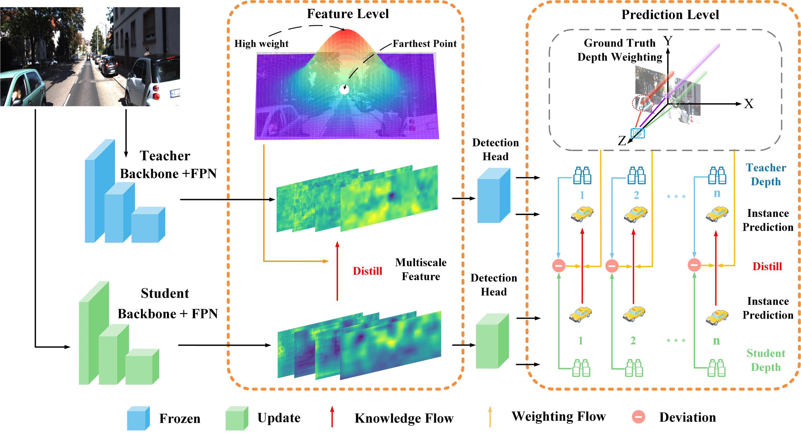

# ISCKD

## 1. 项目简介

### Beyond the Limitation of Monocular 3D Detector via Knowledge Distillation

论文 / Paper: [ICCV 2023 Open Access](https://openaccess.thecvf.com/content/ICCV2023/papers/Yang_Beyond_the_Limitation_of_Monocular_3D_Detector_via_Knowledge_Distillation_ICCV_2023_paper.pdf)



本项目是 ICCV 2023 论文 **《Beyond the Limitation of Monocular 3D Detector via Knowledge Distillation》** 的官方代码实现，围绕**单目 3D 检测器的知识蒸馏**展开：用大 backbone 教师（ResNet101 / RegNetX-3.2GF / Swin）指导轻量学生（MobileNetV2 / ResNet18 / RegNetX-800MF / ShuffleNet / DLA），在 KITTI 单目 3D 检测上突破小模型自身的精度上限。

- **本目录为完整可训练代码**，包含论文 paper3、paper5 两条实验线的全部配置，以及多模态 / 点云基线。
- 仓库母集为 **mmdetection3d `v1.0.0.dev0` 快照**（`mmdet3d/version.py` 仍写作 `0.17.2`，实际位于 0.17.2 之后、mmengine 重构之前），因此同时兼容旧式 `pretrained=` 与新式 `init_cfg=` 两种权重写法。
- 规模：`mmdet3d/` 247 个 `.py`、官方 `configs/` 161 个 `.py`、自定义 `a_configs/` 67 个 `.py`。
- **本文已整合仓库自带的两份原始笔记**：`代码说明.txt`（配置分组 + 自研模块清单，落地为 [§7](#7-自定义模块扩展) 的逐条对照表）、`说明.txt`（可视化 / FLOPs / 测试集提交 / 训练的历史命令，落地为 [§8](#8-训练与评测)，其中失效路径已修正）。原文按原样保留在仓库根，供比对。

> 如果只用一句话：**在特征层用透视先验加权对齐教师-学生的多尺度特征，在预测层用 GT 深度加权对齐实例预测，从而在同等参数量下把单目 3D 检测器推到更高精度。**

## 2. 方法概览

如上图，框架分为**特征层（Feature Level）** 与 **预测层（Prediction Level）** 两级蒸馏，教师（蓝色，冻结）与学生（绿色，更新）共享同一张输入图像。

| 层级             | 对齐对象                                                                 | 权重来源                                                        | 权重传播                           |
| ---------------- | ------------------------------------------------------------------------ | --------------------------------------------------------------- | ---------------------------------- |
| Feature Level    | 教师 / 学生 FPN 多尺度特征（学生先用 1×1 conv 升到 256 通道再逐点对齐） | 以特征图中心为基准的高斯透视先验，越靠近消失点 / 最远点权重越高 | Weighting Flow（上图中的橙色箭头） |
| Prediction Level | 实例级分类、方向、深度、回归预测                                         | GT 深度加权                                                     | 按深度逐实例加权                   |

特征层的权重矩阵与蒸馏损失（`mmdet3d/models/detectors/dis_pgd.py`）：

```python
# forward_train()  —— 生成透视权重矩阵，中心权重最高
dt_level[j][k] = A * math.exp(-(k / w - w_cen / w) ** 2 / sigma_x
                               - (j / h - h_cen / h) ** 2 / sigma_y)

# dis_fea_ada()  —— 加权特征蒸馏（权重作用在通道以外的每个空间点上）
loss_fea = torch.sqrt((torch.pow(ft - fs, 2) * mask.unsqueeze(1)).sum())
sup_loss = loss_fea / len(ft)
```

| 检测器        | 代码位置                                  | `A` | `sigma_x` / `sigma_y` | 总损失缩放            |
| ------------- | ----------------------------------------- | ----- | ------------------------- | --------------------- |
| `DIS_PGD`   | `mmdet3d/models/detectors/dis_pgd.py`   | 0.5   | 0.75 / 0.75               | `self.weight = 100` |
| `DIS_SMOKE` | `mmdet3d/models/detectors/dis_smoke.py` | 0.3   | 0.2 / 0.2                 | `self.weight = 100` |

预测层的分支（`dis_cls` / `dis_KL` / `dis_depth` / `dis_bbox` 等）在 `dis_pgd.forward_train()` 中以注释形式保留，解注释即可组合出 KL、FitNet、AT、FGFI、TAR、DeFeat、GID 等对照方案，方便做消融；默认只启用特征层蒸馏。

### 两条论文实验线与基线

| 实验线                           | 目录                                                    | 核心改动                                                                                                       | 注册名                                      |
| -------------------------------- | ------------------------------------------------------- | -------------------------------------------------------------------------------------------------------------- | ------------------------------------------- |
| **paper3**：进化分区指派   | `a_configs/kitti/PGD_OPA/`                            | 把 OPA 的进化算法分区指派移植到单目 3D，用 geatpy 拟合 cls/reg 损失平面上的最优分界线，替代 PAA 的高斯混合阈值 | `PGD_GA_HEAD`                             |
| **paper5**：知识蒸馏轻量化 | `a_configs/kitti/PGD_big/`、`PGD_mini/`、`smoke/` | 冻结教师 + 轻量学生，特征层透视加权蒸馏                                                                        | `DIS_PGD` / `DIS_SMOKE`、`PGDHeadDIS` |
| 基线                             | `a_configs/kitti/{3dssd,mvxnet}`、`dairv2x/mvxnet`  | 点云单阶段、图像+点云多模态                                                                                    | —                                          |

> `代码说明.txt` 中列出的 **`PGD_cycle`（paper5 循环蒸馏线）未入库**，当前 `a_configs/` 中不存在。

## 3. 仓库结构

```
ISCKD/
├── a_configs/                ★ 自定义实验配置区（67 个 .py），详见 a_configs/README.md
│   ├── dairv2x/mvxnet/       3   DAIR-V2X 多模态检测（数据已转 KITTI 格式）
│   ├── kitti/
│   │   ├── 3dssd/            4   点云单阶段基线 SSD3DNet
│   │   ├── PGD_OPA/          5   paper3：PGD + OPA 进化分区指派
│   │   ├── PGD_big/          6   paper5：大 backbone 教师 / 精度上限
│   │   ├── PGD_mini/        25   paper5：轻量学生 + 蒸馏
│   │   ├── mvxnet/           2   KITTI 多模态基线 MVX-Net
│   │   └── smoke/           11   SMOKE 轻量单目 3D + 蒸馏
│   ├── kitti_old/           11   0.17 仓的 a_configs/kitti 原样归档
│   └── README.md             逐配置接线、路径清单与命名约定
├── configs/                 mmdetection3d 官方配置（161 个 .py，未改动）
├── mmdet3d/                 核心库，含本论文新增模块（见 §7）
├── tools/                   train.py / test.py / create_data.py / dist_*.sh / analysis_tools
├── demo/                    单图推理 demo（mono_det_demo.py 等，默认参数已指向 a_configs）
├── docs/  docs_zh-CN/       上游中英文文档
├── docker/  resources/      部署文件与图片资源
├── tests/                   单元测试
├── yyr_tools/               数据统计小脚本（area_sta.py、dep_sta.py）
├── README_base.md           上游 mmdetection3d 原始 README（保留备查）
├── 代码说明.txt              原始模块笔记 → 内容已整合进 §7（逐条对照表）
└── 说明.txt                  原始命令笔记 → 内容已整合进 §8（失效路径已修正）
```

## 4. 环境准备

版本约束写在 `mmdet3d/__init__.py` 的断言里，**不满足会直接 `AssertionError` 退出**：

| 依赖           | 版本范围                                                               |
| -------------- | ---------------------------------------------------------------------- |
| mmcv-full      | `>=1.3.8, <=1.4.0`                                                   |
| mmdet          | `>=2.14.0, <=3.0.0`                                                  |
| mmsegmentation | `>=0.14.1, <=1.0.0`                                                  |
| PyTorch        | 1.3+（与实际 CUDA 匹配）                                               |
| geatpy         | 仅 `PGD_OPA` 需要（`pgd_ga_head.py` 顶部 `import geatpy as ea`） |

一组参考安装步骤（CUDA 11.1 示例，按本机驱动调整 torch 版本）：

```bash
conda create -n isckd python=3.8 -y && conda activate isckd

pip install torch==1.10.0 torchvision==0.11.0 \
    -f https://download.pytorch.org/whl/cu111/torch_stable.html
pip install mmcv-full==1.4.0 \
    -f https://download.openmmlab.com/mmcv/dist/cu111/torch1.10.0/index.html
pip install mmdet==2.28.2 mmsegmentation==0.30.0
pip install -r requirements/runtime.txt
pip install -e .

pip install geatpy          # 仅训练 PGD_OPA 时需要
```

验证：

```bash
python -c "import mmdet3d; print(mmdet3d.__version__)"   # 期望 0.17.2
```

## 5. 数据准备

只用到 **KITTI 3D 目标检测**（`KittiDataset` + `mono3d` 标注），`a_configs/kitti/3dssd` 走同一套数据的点云分支；`a_configs/dairv2x/mvxnet` 需要把 DAIR-V2X 离线转成 KITTI 格式（`kitti_infos_{train,val}.pkl`、`img_scale=(960,540)`）。

原始数据目录（以 `/home/data/kitti/` 为例）：

```
kitti/
├── image_2/  label_2/  calib/          # 单目 3D 必需
├── velodyne/                           # 点云分支（3dssd / mvxnet）需要
└── ImageSets/                          # train.txt / val.txt / test.txt
```

生成 `KITTI_new/`（infos pkl、mono3d coco json、reduced point cloud）的命令见 §8 的「KITTI 数据准备」。

> ⚠️ 全部 67 个配置的 `data_root`、预训练权重、教师权重**都是云服务器绝对路径**（`/home/...`、`/workspace/...`），配置里没有任何相对路径兜底。本地跑之前必须逐项改写，清单见 [`a_configs/README.md`](a_configs/README.md)

## 6. 实验配置索引

`a_configs/` 与官方 `configs/` 平行存放，共 67 个 `.py`，全部通过 AST 解析与 `_base_` 断链检查。各目录的继承链、backbone、bs、lr、epoch 与教师权重路径，见 **[`a_configs/README.md`](a_configs/README.md)**，这里只给入口速查：

| 场景                | 入口配置                                                                                           |
| ------------------- | -------------------------------------------------------------------------------------------------- |
| paper3 进化分区指派 | `a_configs/kitti/PGD_OPA/pgd_ga.py`                                                              |
| paper3 基线（PAA）  | `a_configs/kitti/PGD_OPA/pgd_r101_caffe_fpn_gn-head_3x4_4x_kitti-mono3d.py`                      |
| paper5 教师 / 上限  | `a_configs/kitti/PGD_big/PGD_{reg3.2,swint,swins,swinb,swinl}.py`                                |
| paper5 学生         | `a_configs/kitti/PGD_mini/PGD_{mobv2,r18,reg800,shuf}[_h].py`                                    |
| paper5 蒸馏         | `a_configs/kitti/PGD_mini/Dis_PGD_*.py`（16 个）                                                 |
| SMOKE 线蒸馏        | `a_configs/kitti/smoke/Dis_smoke_*.py`（5 个）                                                   |
| 多模态 / 点云基线   | `a_configs/kitti/mvxnet/*.py`、`a_configs/dairv2x/mvxnet/*.py`、`a_configs/kitti/3dssd/*.py` |

命名记号（`_h` 半宽、`_q` 四分之一宽、`_reg`/`_swint`/`_swinl` 标识**教师身份**、`smoke<数字>` 为 DLANet 深度）见 `a_configs/README.md` §3。

## 7. 自定义模块扩展

新增模块全部位于 `mmdet3d/models/` 下，并且**必须**在对应 `__init__.py` 注册后才能被配置字符串解析（例如 `type='DIS_PGD'`）。

| 文件                                           | 行数 | 注册名              | 论文   | 说明                                                                                                                                                  |
| ---------------------------------------------- | ---- | ------------------- | ------ | ----------------------------------------------------------------------------------------------------------------------------------------------------- |
| `mmdet3d/models/dense_heads/pgd_ga_head.py`  | 1818 | `PGD_GA_HEAD`     | paper3 | 继承 `FCOSMono3DHead`，`ga_reassign()` 内用 `ea.soea_DE_rand_1_bin_templet` 拟合分区线                                                          |
| `mmdet3d/models/dense_heads/pgd_head_dis.py` | 1369 | `PGDHeadDIS`      | paper5 | 蒸馏头，新增 `loss_stu()` 导出正样本的 cls / bbox / dir / depth 中间量给教师侧对齐                                                                  |
| `mmdet3d/models/detectors/dis_pgd.py`        | 802  | `DIS_PGD`         | paper5 | `FCOSMono3D` + 冻结 `tea_model`，`forward_train` 组装特征层 / 预测层蒸馏损失                                                                    |
| `mmdet3d/models/detectors/dis_smoke.py`      | 476  | `DIS_SMOKE`       | paper5 | `SMOKEMono3D` 版本，透视参数 `A=0.3, sigma=0.2`                                                                                                   |
| `mmdet3d/models/backbones/shuffleNet.py`     | 207  | `ShuffleNet`      | paper5 | 学生 backbone，FPN 输入通道 `[48, 480, 960, 1920]`                                                                                                  |
| `mmdet3d/models/backbones/swin.py`           | 1220 | `SwinTransformer` | paper5 | 教师 backbone（dev0 原生不含，来自较新 release 的拷贝，来源待确认）                                                                                   |
| `mmdet3d/models/backbones/mobilenet_v2.py`   | 196  | `MobileNetV2`     | —     | 类内已 `@BACKBONES.register_module()`，但 `backbones/__init__.py` **未导入**，当前不参与任何实验（配置用的是 mmdet 自带的 `MobileNetV2`） |

对应注册文件：

```
mmdet3d/models/backbones/__init__.py     → ShuffleNet, SwinTransformer
mmdet3d/models/dense_heads/__init__.py   → PGD_GA_HEAD, PGDHeadDIS
mmdet3d/models/detectors/__init__.py     → DIS_PGD, DIS_SMOKE
```

### 与 `代码说明.txt` 的逐条对照

`代码说明.txt` 是作者留下的原始模块笔记（两条 todo），下表把它的每一条落到本仓库的实际文件，并标出**笔记与现状不符的地方**：

| 原始笔记条目                        | 笔记内容                                  | 当前落地位置                                                           | 与仓库现状的差异                                                                                                   |
| ----------------------------------- | ----------------------------------------- | ---------------------------------------------------------------------- | ------------------------------------------------------------------------------------------------------------------ |
| todo 1 · `PGD_OPA`               | paper3                                    | `a_configs/kitti/PGD_OPA/`（5 个）                                   | —                                                                                                                 |
| todo 1 · `PGD_big`、`PGD_mini` | paper5                                    | `a_configs/kitti/PGD_big/`（6）、`a_configs/kitti/PGD_mini/`（25） | —                                                                                                                 |
| todo 1 · **`PGD_cycle`**   | paper5 循环蒸馏线                         | **不存在**                                                       | 目录未入库，见 [§9](#9-已知问题) 第 8 条                                                                           |
| todo 1 · `smoke`                 | 蒸馏线                                    | `a_configs/kitti/smoke/`（11）                                       | —                                                                                                                 |
| todo 1 · `3dssd`                 | 点云基线                                  | `a_configs/kitti/3dssd/`（4）                                        | —                                                                                                                 |
| todo 2(1) · `ShuffleNet.py`      | paper5 backbone                           | `mmdet3d/models/backbones/shuffleNet.py`                             | 已注册，正在使用（注意文件名是大写 N：`shuffleNet.py`）                                                          |
| todo 2(1) · `Mobilenet_v2.py`    | paper5 backbone                           | `mmdet3d/models/backbones/mobilenet_v2.py`                           | 文件在且类已注册，但 `__init__.py` **未导入** → 实际未参与实验，见 §9 第 6 条                            |
| todo 2(2) · `pgd_ga_head.py`     | paper3 检测头                             | `mmdet3d/models/dense_heads/pgd_ga_head.py`                          | 已注册                                                                                                             |
| todo 2(2) · `pgd_head_dis.py`    | paper5 蒸馏头                             | `mmdet3d/models/dense_heads/pgd_head_dis.py`                         | 已注册                                                                                                             |
| todo 2(3) · `dis_pgd.py`         | paper5 检测器                             | `mmdet3d/models/detectors/dis_pgd.py`                                | 已注册；另有笔记未提到的 `dis_smoke.py`                                                                          |
| 注册提示（三处重复）                | "在 `_init_.py` 添加自己新注册的 heads" | 上述三个 `__init__.py`                                               | 笔记文件名写作 `_init_.py`，**实际是 `__init__.py`**（双下划线）；且 backbone / detector 注册的不是 head |

> 想新增自己的模块：① 在 `mmdet3d/models/<backbones|dense_heads|detectors>/` 下写类并加 `@XXX.register_module()`；② 在**同级** `__init__.py` 里 `from .your_file import YourClass` 并把类名加进 `__all__`；③ 配置里用 `type='YourClass'` 引用。缺第 ② 步会在 build 阶段报 `KeyError: 'YourClass is not in the models registry'`。

## 8. 训练与评测

> 本节整合了仓库根 `说明.txt` 的**全部**命令（可视化、mAP 评测、FLOPs、测试集提交、训练任务、数据准备），并把其中已失效的 `a_configs/kitti/PGD/` 路径改写为现存的 `a_configs/kitti/PGD_OPA/`（对应关系见 [§9](#9-已知问题) 第 7 条）。环境激活与 GPU 编号按各自机器调整。

**训练（单卡）**

```bash
python tools/train.py a_configs/kitti/PGD_OPA/pgd_ga.py
```

**训练（指定显卡编号）**

```bash
CUDA_VISIBLE_DEVICES=1 python3 tools/train.py a_configs/dairv2x/mvxnet/mvx50.py
```

**训练（多卡分布式）**

```bash
CUDA_VISIBLE_DEVICES=0,1 PORT=28456 bash tools/dist_train.sh a_configs/dairv2x/mvxnet/mvx50.py 2
```

**训练（Swin-L 教师蒸馏）**：原笔记在 4/5/7 三张卡上各起了一次同一配置

```bash
CUDA_VISIBLE_DEVICES=4 python3 tools/train.py a_configs/kitti/PGD_mini/Dis_PGD_swint_swinl.py
CUDA_VISIBLE_DEVICES=5 python3 tools/train.py a_configs/kitti/PGD_mini/Dis_PGD_swint_swinl.py
CUDA_VISIBLE_DEVICES=7 python3 tools/train.py a_configs/kitti/PGD_mini/Dis_PGD_swint_swinl.py
```

**测试 + 可视化**（`--show-dir` 走 `show_multi_modality_result2`：`score_thr=0.8` 过滤、预测框绿色、GT 与预测分目录保存）

```bash
# paper3 进化分区指派
python tools/test.py a_configs/kitti/PGD_OPA/pgd_ga.py \
    work_dirs/demo/epoch_48.pth \
    --show --show-dir ./vis/pgd/pgd_ga_100_50

# paper3 基线（R101 + PAA），原笔记权重目录沿用 pgd_r101_caffe_fpn_gn-head_3x4_4x_kitti-mono3d
CUDA_VISIBLE_DEVICES=0 python tools/test.py \
    a_configs/kitti/PGD_OPA/pgd_r101_caffe_fpn_gn-head_3x4_4x_kitti-mono3d.py \
    work_dirs/pgd_r101_caffe_fpn_gn-head_3x4_4x_kitti-mono3d/epoch_40.pth \
    --show --show-dir ./vis/pgd_new
```

**测试 + 评测 mAP**

```bash
python tools/test.py a_configs/kitti/PGD_OPA/pgd_ga.py \
    work_dirs/demo/epoch_48.pth \
    --eval mAP
```

**KITTI 测试集提交格式**

```bash
python tools/test.py a_configs/kitti/PGD_mini/Dis_PGD_r18_h.py <checkpoint.pth> \
    --format-only \
    --eval-options pklfile_prefix=./pgd_kitti_results submission_prefix=./pgd_kitti_results
```

`说明.txt` 中留存的原始实例（权重目录为云端的 `work_dirs_GAUSS_sigma`，注意透视参数用的是 `A=0.3` 而非 `dis_pgd.py` 默认的 0.5）：

```bash
CUDA_VISIBLE_DEVICES=2 python tools/test.py a_configs/kitti/PGD_mini/Dis_PGD_r18_h.py \
    /workspace/mmdetection3d-master/work_dirs_GAUSS_sigma/Dis_PGD_r18_gauss_A=0.3_sigma=0.75/epoch_48.pth \
    --format-only --eval-options 'pklfile_prefix=./pgd_kitti_results' 'submission_prefix=./pgd_kitti_results'
```

**单图推理（demo）**

```bash
python demo/mono_det_demo.py \
    --image  --ann <mono3d.coco.json> \
    --config a_configs/kitti/PGD_OPA/pgd_r101_caffe_fpn_gn-head_3x4_4x_kitti-mono3d.py \
    --checkpoint work_dirs/pgd_101_2/latest.pth \
    --score-thr 0.7 --out-dir demo
```

**参数量 / FLOPs 分析**

`说明.txt` 里按实验线排了一整组，下面补全并修正了其中的失效项：

```bash
# 教师 / 上限
CUDA_VISIBLE_DEVICES=3 python3 tools/analysis_tools/get_flops.py a_configs/kitti/PGD_OPA/pgd_r101_caffe_fpn_gn-head_3x4_4x_kitti-mono3d.py
CUDA_VISIBLE_DEVICES=3 python3 tools/analysis_tools/get_flops.py a_configs/kitti/PGD_big/PGD_reg3.2.py

# 学生（标准 / 半宽）
CUDA_VISIBLE_DEVICES=3 python3 tools/analysis_tools/get_flops.py a_configs/kitti/PGD_mini/PGD_r18.py
CUDA_VISIBLE_DEVICES=3 python3 tools/analysis_tools/get_flops.py a_configs/kitti/PGD_mini/PGD_r18_h.py
CUDA_VISIBLE_DEVICES=3 python3 tools/analysis_tools/get_flops.py a_configs/kitti/PGD_mini/PGD_reg800.py
CUDA_VISIBLE_DEVICES=3 python3 tools/analysis_tools/get_flops.py a_configs/kitti/PGD_mini/PGD_mobv2.py
CUDA_VISIBLE_DEVICES=3 python3 tools/analysis_tools/get_flops.py a_configs/kitti/PGD_mini/PGD_mobv2_h.py
CUDA_VISIBLE_DEVICES=3 python3 tools/analysis_tools/get_flops.py a_configs/kitti/PGD_mini/PGD_shuf.py
CUDA_VISIBLE_DEVICES=3 python3 tools/analysis_tools/get_flops.py a_configs/kitti/PGD_mini/PGD_shuf_h.py

# 蒸馏配置（`DIS_PGD` 内同时构建了冻结教师，统计时教师一并计入）
CUDA_VISIBLE_DEVICES=3 python3 tools/analysis_tools/get_flops.py a_configs/kitti/PGD_mini/Dis_PGD_reg800h.py

# SMOKE 线（笔记里写的是 smoke.py，该文件不存在，应为 smoke34.py，见 §9 第 7 条）
python3 tools/analysis_tools/get_flops.py a_configs/kitti/smoke/smoke34.py
```

**KITTI 数据准备**（生成 `KITTI_new/` 下的 infos 与 reduced point cloud）

```bash
python tools/create_data.py kitti --root-path /home/data/kitti/ --out-dir /home/data/KITTI_new/ --extra-tag kitti
```

**训练任务清单**（`说明.txt` 的「todo 训练任务」，原笔记按两批排布：上 4 个 ResNet18 / RegNetX-800MF 蒸馏，下 4 个 MobileNetV2 / ShuffleNet 蒸馏）

```
a_configs/kitti/PGD_mini/Dis_PGD_r18_h.py
a_configs/kitti/PGD_mini/Dis_PGD_r18.py
a_configs/kitti/PGD_mini/Dis_PGD_reg800h.py
a_configs/kitti/PGD_mini/Dis_PGD_reg800.py
a_configs/kitti/PGD_mini/Dis_PGD_mobv2.py
a_configs/kitti/PGD_mini/Dis_PGD_mobv2_reg.py
a_configs/kitti/PGD_mini/Dis_PGD_shuf.py
a_configs/kitti/PGD_mini/Dis_PGD_shuf_reg.py
```

## 9. 已知问题

> 类别标签：`[代码bug]` `[配置错配]` `[疑似bug]` `[路径失效]` `[孤儿模块]` `[文档过时]` `[缺失]` `[来源待确认]`。
> 修复后请把对应条目移入「已修复」并保留记录。

1. **[代码bug] `pgd_head.py:781` 空 GT 分支 `UnboundLocalError`**：`weight_dim != -1` 且当前图像无正样本时，`loss_fuse_depth *= torch.exp(-pos_weights[:, 0].sum())` 使用了该分支内尚未赋值的 `loss_fuse_depth`（官方顺序是先算 sum 再乘）。**`PGD_big` 全部 5 个配置 `weight_dim=1`，均受影响**。
2. **[配置错配] `Dis_smoke_102_34.py` / `Dis_smoke_102_60.py` 教师结构与权重不符**：`tea_model` 建的是 **DLA60**，却加载 `smoke102/epoch_72.pth`；`strict=False` 会静默跳过不匹配键，蒸馏实际失效或退化。
3. **[配置错配] `Dis_smoke_res101_dla34.py` 名不副实**：教师实为 DLA60（权重 `smoke60`），文件名中的 `res101` 没有对应结构。
4. **[疑似bug] `smoke_h.py` head 输入通道与 neck 输出不一致**：`bbox_head.in_channels=32`，而 `DLANeck(start_level=2)` 输出 **64** 通道（neck 未同步修改），前向会形状报错；对照 `smoke_q.py` 同位置为 64。另 `Dis_smoke_h.py` 学生只把 branch 减半（in/feat 仍 64），与 `smoke_h` 的口径不一致，需确认哪个是实验本意。
5. **[路径失效] 所有 `data_root` / `checkpoint` / `tea_pretrained` 指向云端路径**（`/home/...`、`/workspace/...`），本地运行全部需要改写
6. **[孤儿模块] `mmdet3d/models/backbones/mobilenet_v2.py` 未注册**：配置实际使用的是 mmdet 自带的 `MobileNetV2`，该文件当前不参与任何实验。
7. **[文档过时] `说明.txt` 路径已失效**：`a_configs/kitti/PGD/PGD_ga.py`、`a_configs/kitti/PGD/pgd_r101_...py` 现为 `a_configs/kitti/PGD_OPA/` 下同名文件（或归档于 `kitti_old/PGD/`）；`a_configs/kitti/smoke/smoke.py` 不存在，应为 `smoke34.py`。
8. **[缺失] `PGD_cycle` 目录未入库**：`代码说明.txt` 将 paper5 列为 `PGD_big/PGD_mini/PGD_cycle`，但 a_configs 中无 `PGD_cycle`。
9. **[来源待确认] `mmdet3d/models/backbones/swin.py`**：带 OpenMMLab 官方头、来自较新 release 的拷贝（dev0 原生不含 Swin），`PGD_big`/`PGD_mini` 的 Swin 配置依赖它，需确认版本与 mmdet 2.x 的兼容性。

## 10. 结果

论文按 KITTI 官方协议报告 *val* 集上的 `AP_3D | AP_BEV`（`Car`，IoU=0.7，分 Easy / Moderate / Hard），对比的是"同结构教师 vs 轻量学生 vs 学生+蒸馏"三者的精度与参数量。对应的实验配置与教师权重路径已整理进 `a_configs/kitti/PGD_mini`、`a_configs/kitti/smoke`；**具体数值请以论文与各自 `work_dirs/*/` 日志为准**，本仓库不重复粘贴未经复现的数字。

复现后可这样把 loss 曲线拉出来（`resources/loss_curve.png` 为示例）：

```bash
python tools/analysis_tools/analyze_logs.py plot_curve \
    work_dirs/<exp>/<timestamp>.log.json \
    --keys loss loss_stu_fea --legend loss loss_stu_fea --out result/loss.png
```

## 11. 引用

```bibtex
@inproceedings{yang2023beyond,
  title     = {Beyond the Limitation of Monocular 3D Detector via Knowledge Distillation},
  author    = {Yang, Y. and others},
  booktitle = {Proceedings of the IEEE/CVF International Conference on Computer Vision (ICCV)},
  year      = {2023}
}
```

如果本仓库使用的 mmdetection3d 也帮到了你，请一并引用上游：

```bibtex
@misc{mmdet3d2020,
    title={{MMDetection3D: OpenMMLab} next-generation platform for general {3D} object detection},
    author={MMDetection3D Contributors},
    howpublished = {\url{https://github.com/open-mmlab/mmdetection3d}},
    year={2020}
}
```

## 12. 致谢与许可

- 本仓库基于 [MMDetection3D](https://github.com/open-mmlab/mmdetection3d)（Apache 2.0）构建，感谢 OpenMMLab 的 [MMCV](https://github.com/open-mmlab/mmcv)、[MMDetection](https://github.com/open-mmlab/mmdetection)、[MMSegmentation](https://github.com/open-mmlab/mmsegmentation)。
- 蒸馏的对照实现思路参考 FitNet / AT / FGFI / TAR / DeFeat / GID 等在 `dis_pgd.py` 中保留的分支。
- 数据集：[KITTI 3D Object Detection](http://www.cvlibs.net/datasets/kitti/eval_object.php?obj_benchmark=3d)、[DAIR-V2X](https://thudair.baai.ac.cn/index)。
- 论文内容版权归原作者所有。
